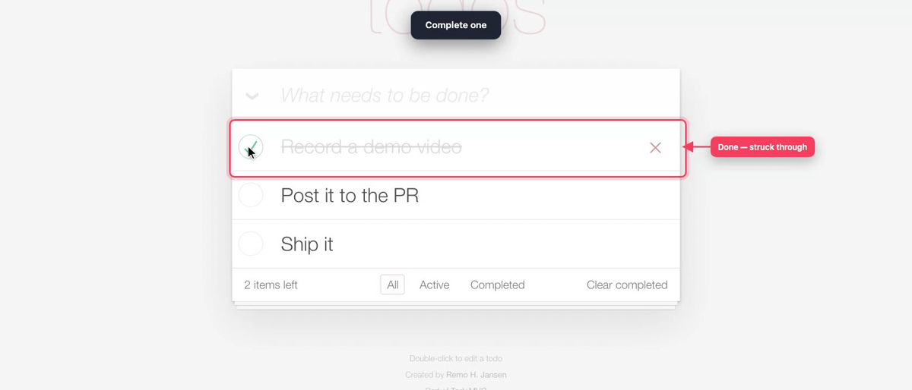

# demo-recorder

**Polished, narrated demo videos of any web app — recorded by your coding agent, posted to your PR.**

A [Claude Code](https://claude.com/claude-code) plugin (also a plain CLI) that drives a real flow in
your running app with Playwright and produces a video that looks hand-made: a human-like cursor,
a caption bar above the app with the current step, arrow callouts on the exact change, camera zoom
on the key moments, clean screenshots of the components that changed, dead time (spinners, AI
answers) fast-forwarded, and — optionally — a realistic voice reading each step. Then it can post
the video and screenshots to the pull request.



- **Zero footprint in your repo** — Playwright lives in `~/.demo-recorder`; nothing to install in the app.
- **Demos are data** — a JSON manifest of steps you can edit and re-run (or a Playwright spec when you need logic).
- **Per-project settings** — URL, start commands, auth, never-click rules — in one `project.json`.
- **Captions never cover the app** — the step title sits in a fixed bar above the page, in the same spot all video long.
- **Optional voice-over** — `--voice` reads each step title aloud with [Chatterbox](https://github.com/resemble-ai/chatterbox) TTS, clear and natural, at the energy you pick; local, free, cached.
- **Verified, not hoped** — every run emits a frame per caption and a contact sheet to check before sharing.
- **PR-ready** — inline video in the PR comment, screenshots in a grid, or a per-PR page with one tab per recording.

## Install

**As a Claude Code plugin (recommended)** — inside Claude Code:

```
/plugin marketplace add shlior7/demo-recorder
/plugin install demo-recorder@demo-recorder
```

Update later with `/plugin` → Installed → demo-recorder → Update.

**As a plain skill** (no plugin system):

```bash
git clone https://github.com/shlior7/demo-recorder ~/demo-recorder
ln -s ~/demo-recorder/skills/demo-recorder ~/.claude/skills/demo-recorder
```

**As a CLI** (no agent): use `skills/demo-recorder/record-demo.sh` directly — everything below works by hand.

### Requirements

- Node.js 18+ and `npm` (Playwright + Chromium are installed into `~/.demo-recorder` on first run)
- `ffmpeg` (mp4 output, fast-forward, contact sheets) — `brew install ffmpeg` / `apt install ffmpeg`
- `git`, and the [`gh` CLI](https://cli.github.com) logged in — only for posting to PRs
- macOS or Linux (importing an existing browser login with `--from` is macOS-only)
- Voice only: Python 3.10+ — `--voice` installs Chatterbox (PyTorch + ~3 GB of model weights) into `~/.demo-recorder/voice` on first use; Apple Silicon (MPS) or a CUDA GPU makes it fast

## Try it in 1 minute

```bash
R=~/.claude/skills/demo-recorder   # or the plugin's skills/demo-recorder directory
$R/record-demo.sh <path-to-this-repo>/examples/todomvc.json --open
```

This records a 30-second tour of the public [TodoMVC demo](https://demo.playwright.dev/todomvc) and
prints `file://` links to the video, screenshots and verification frames.

## Use it on your app

With Claude Code, just ask — the skill does the rest:

> *"Record a demo of what changed on my branch"* · *"Record PR 123 and post it to the PR"* ·
> *"Make a walkthrough video of the new checkout flow"*

The agent reads the diff, plans a storyboard, starts the right servers, writes a manifest, records,
checks every frame, and hands you the video. By hand:

```bash
cd my-app
$R/record-demo.sh init          # scaffolds ~/.demo-recorder/projects/my-app/project.json (detects dev script + port)
$R/record-demo.sh up            # starts your app from project.json, waits until it answers
$R/record-demo.sh probe --url http://localhost:3000/settings   # ARIA tree + screenshot to pick locators
$R/record-demo.sh ~/.demo-recorder/projects/my-app/demos/settings.json --open
$R/record-demo.sh down
```

## Project settings — `project.json`

Everything that differs between apps. Created by `init`; lives in
`~/.demo-recorder/projects/<name>/project.json` (personal) or `<repo>/.demo-recorder/project.json`
(`init --team`, commit it to share with your team). See [`examples/project.json`](examples/project.json).

| key | what |
|---|---|
| `baseUrl` | where the app is served |
| `start[]` | processes to run: `{ name, cwd, command, ready, env }` — `ready` is a URL that answers once up |
| `auth` | name of a saved login (`record-demo.sh login …`) or `null` |
| `viewport`, `colorScheme` | default `1680x1050`, `light` |
| `forbid` | text patterns no demo may click (`"/delete/i"`, `"Publish"`) — a safety net for real data |
| `failOn` | error UI that makes waits fail fast (`{ "text": "/something went wrong/i" }`) |
| `localStorage` | key-prefix → value, to pre-dismiss onboarding tours and cookie banners |
| `look` | per-project caption/callout style |

## Demos — JSON manifests

```json
{
  "title": "Bulk rename",
  "steps": [
    { "goto": "./items" }, { "start": true },
    { "caption": "Bulk rename · many items at once", "hold": 2000 },
    { "click": { "role": "checkbox", "name": "Select all" } },
    { "zoom": { "role": "button", "name": "Rename" }, "do": [{ "click": { "role": "button", "name": "Rename" } }] },
    { "type": { "label": "New name" }, "text": "Archived {name}" },
    { "callout": { "testId": "preview" }, "text": "Live preview of every rename" },
    { "shot": "rename-preview", "target": { "testId": "preview" } },
    { "actAndWait": { "role": "button", "name": "Apply" }, "caption": "Applying", "busy": { "css": "[aria-busy=true]" } },
    { "caption": "Done", "hold": 2000 }
  ]
}
```

Steps: `goto` `start` `request` `caption` `hud` `click` `tap` `type` `press` `wait` `waitFor`
`actAndWait` `zoom` `callout` `clearCallouts` `shot` `snapshot` (any step can be `"optional": true`).
Locators: `"Text"`, `{ role, name }`, `{ testId }`, `{ label }`, `{ placeholder }`, `{ text }`,
`{ css }`, scoped with `"in"`. `routes` replay network responses (e.g. an AI endpoint) for
deterministic takes. Full reference: the header of
[`runner/manifest.spec.ts`](skills/demo-recorder/runner/manifest.spec.ts). Need loops or logic? Write a
spec instead: `import { test, demo } from 'demo-recorder'` — see [`examples/todomvc.spec.ts`](examples/todomvc.spec.ts).

### Recording a terminal (CLI, TUI, Claude Code)

Serve it in the browser with [ttyd](https://github.com/tsl0922/ttyd) and record the page — with the
DOM renderer, so the text is real DOM that locators and callouts can find:

```bash
ttyd -p 7681 -W -t rendererType=dom -t fontSize=19 -t disableLeaveAlert=true env PS1='$ ' PAGER=cat bash --norc
$R/record-demo.sh examples/terminal.spec.ts --url http://127.0.0.1:7681
```

[`examples/terminal.spec.ts`](examples/terminal.spec.ts) types at the cursor, waits for the next
prompt, and calls out a row. Keep the whole take on that one page (navigating away kills the
shell). Recording Claude Code started from inside Claude Code? Unset the inherited `CLAUDE*`
variables before `ttyd` (`for v in $(env | grep -oE "^CLAUDE[A-Z_]*"); do unset $v; done`), or the inner session won't save
its transcript.

## Output

```
~/.demo-recorder/videos/<project>/<demo>-<timestamp>.mp4     H.264 (+ AAC voice), plays everywhere
                                  …-shots/*.png             clean stills for the PR / ticket
                                  …-steps/*.png             one frame per caption/callout — check these
                                  …-sheet.png               3×3 contact sheet
                                  …-chapters.json           every caption, callout, fast-forward and still, in final-video seconds
```

`-chapters.json` is for anything that plays the take — a player, the PR page, a preview inside
another recording: `[{ "t": 4.07, "end": 4.39, "kind": "fastForward", "text": "…" }, …]` with
`kind` one of `caption` · `callout` · `fastForward` (has `end`) · `still` · `cut`.

## Sharing to the PR

```bash
$R/record-demo.sh share <video.mp4> --repo <checkout> [--pr 123] [--title "…"] [--dry-run]
```

How the video travels is a setting (`record-demo.sh config share.video <mode>`):

| mode | in the PR comment | setup |
|---|---|---|
| `attach` | **plays inline**, screenshots in a grid | a GitHub web session: `record-demo.sh login github --from chrome` (or `brave`) imports your existing browser login; or `login https://github.com/login github` to log in once. GitHub has no API for comment attachments, so tokens can't do this. |
| `page` | a ▶ poster linking to a **per-PR page** — one tab per recording, seekable player, screenshot gallery | a static host (below) |
| `link` | a download link | none |

Screenshots (and the page poster) are stored on a `demo-assets` branch of the repo, written without
touching your checkout; the branch has no workflows, so it triggers no CI. The agent asks once
whether to post to PRs/tickets *always*, *ask each time*, or *never* (`share.pr`, `share.jira`).

### Hosting the per-PR page (`share.video page`)

Any static host with a CLI works — `{dir}` is the page folder, `{slug}` the per-PR name:

```bash
# Cloudflare Pages
record-demo.sh config share.page.deploy 'npx wrangler pages deploy {dir} --project-name demos --branch {slug}'
record-demo.sh config share.page.url    'https://{slug}.demos.pages.dev/'
# Amazon S3 (+ CloudFront or a bucket website)
record-demo.sh config share.page.deploy 'aws s3 sync {dir} s3://my-demos/{slug}/ --delete'
record-demo.sh config share.page.url    'https://my-demos.s3.amazonaws.com/{slug}/index.html'
# Netlify
record-demo.sh config share.page.deploy 'npx netlify-cli deploy --dir {dir} --alias {slug} --site $NETLIFY_SITE_ID'
record-demo.sh config share.page.url    'https://{slug}--my-demos.netlify.app/'
```

Optional `share.page.pull` (same placeholders) downloads an existing page first, so tabs recorded
on another machine are kept. Recordings of private work should go to a host with access control.

## Settings — `record-demo.sh config`

| key | values |
|---|---|
| `hud.position` | `top` (a bar above the page, default) · `bottom` (a bar below it) · `overlay` (floating on the page) · `off` |
| `hud.size`, `hud.theme` | `sm`/`md`/`lg`, `dark`/`light` |
| `hud.wpm`, `hud.minMs` | reading speed and floor for how long every caption/callout stays up |
| `voice.enabled` | `true` = always narrate (same as passing `--voice`; `--no-voice` overrides) |
| `voice.energy` | `calm` · `warm` · `upbeat` (default) · `rainbow` (max excitement) |
| `voice.exaggeration`, `voice.cfg`, `voice.temperature` | fine-tune the level: emotion (0.5 ≈ neutral), pacing (lower = livelier), variation (lower = steadier, clearer) |
| `voice.ref` | path to a 10–30 s `.wav` of a voice to clone (empty = Chatterbox's built-in voice) |
| `callout.color`, `callout.ring`, `callout.inShots` | colour, ring around the target, keep callouts in stills |
| `share.pr`, `share.jira` | `always` · `ask` · `never` |
| `share.video` | `attach` · `page` · `link` |
| `share.page.deploy` / `.url` / `.pull`, `share.assetsBranch` | see above |

## Voice-over

```bash
$R/record-demo.sh voice "Ask the chat for a better description"   # one-time install + a sample with your settings
$R/record-demo.sh <demo.json> --voice                              # every step title read aloud
```

Each caption is spoken once it appears, and stays on screen until its line has finished — so the
video paces itself to the voice. Clips are cached by text and settings (re-takes only synthesise
what changed), and the seconds spent synthesising are cut from the video. Symbols are spoken
sensibly (`·` and `—` become pauses, `→` "to"). Chatterbox runs locally; its output carries
Resemble AI's inaudible watermark.

## Security notes

- Saved logins (`~/.demo-recorder/auth/*.json`, mode 600) **are** your sessions — treat them like passwords.
- `login --from` reads a temporary copy of your browser's cookie database and keeps only the domain you name.
- `forbid` is a safety net, not a sandbox — record against local or staging data, never production.
- The repo you record is never modified; worktrees, logs and data the agent creates live in `~/.demo-recorder`.

## License

MIT
